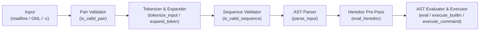

# minishell

[한국어](README.md) · [English](README.en.md)

A Unix shell written in C with GNU Readline and a custom `libft` as part of the 42 Gyeongsan curriculum.  
It covers the full shell pipeline from input pair validation and quote-masked expansion to recursive-descent AST parsing, redirection/pipeline evaluation, and process signal isolation.

- **Timeline**: 2025.07.14 – 2025.08.30 (273 commits, compiled with `-Wall -Wextra -Werror`, 42 Norminette compliant)
- **Authors**: [`yoshin`](https://github.com/gdtknight) · [`jyoo`](https://github.com/Sunbear95)

---

## Architecture & Execution Pipeline

Every command line passes through six stages before and during execution:



### How Each Stage Works

1. **Input Acquisition (`srcs/main.c`)**
   - Reads interactive prompts with `readline(PROMPT)` and records history (`add_history`) when attached to a TTY.
   - Falls back to `get_next_line(STDIN_FILENO)` in piped or nested non-TTY runs.
   - Supports direct one-off execution via `minishell -c "<command>"`.
2. **Pair & Sequence Validation (`srcs/utils/pair_validator.c`, `srcs/tokenize/token_validatation.c`)**
   - `is_valid_pair()` rejects unclosed `'`, `"`, or trailing `\` escape sequences up front.
   - `is_valid_sequence()` catches leading operators, unbalanced parentheses, and redirections missing a `TK_WORD` target.
3. **Quote-Masked Tokenization & Expansion (`srcs/tokenize/`, `srcs/expand/`)**
   - Each `t_exp_token` pairs its string `value` with a parallel character mask (`qmask`: `MASK_UNQUOTED`, `MASK_QUOTED`, `MASK_IFS`).
   - Expansion runs in order: tilde expansion (`~`, `~username`) → parameter expansion (`$VAR`, `$?`, `$$`, `$!`, `$0`) → IFS field splitting (`split_field`) → quote removal (`quote_removal`). Keeping quote context in `qmask` prevents quoted whitespace inside expanded variables from being split.
   - `check_ambigous()` catches redirection targets that split into multiple words and aborts with `ambigous redirect`.
4. **Recursive-Descent AST Parser (`includes/ast.h`, `srcs/ast/`)**
   - Parses tokens by operator precedence (`;`/`&` → `&&`/`||` → `|`/`|&` → simple command or `(...)` compound command) into a tagged-union `t_syntax_node` tree.
   - Splits each simple command into `prefix` (leading redirections and `VAR=val` assignments), `cmd_word`, and `suffix` (arguments and trailing redirections).
5. **Two-Pass Heredoc & Command Execution (`srcs/evaluation/`, `srcs/execution/`)**
   - `eval_heredoc()` traverses the AST before command evaluation, collecting `<<` blocks in a child process and expanding variables via `expand_heredoc_input()` when the delimiter is unquoted.
   - `eval_pipeline()` forks left and right children and closes unused pipe descriptors in both parent and child processes to prevent fd leaks and hung reads.
   - Redirected builtins restore standard descriptors afterward with `restore_tty()`.
6. **Hashmap Environment Store & Signal Isolation (`srcs/hashmap/`, `srcs/shell/`)**
   - Deep-copies `envp` into a 1024-bucket chained hash table (`t_hash_map`) at startup so `export`, `unset`, `env`, and prefix assignments (`VAR=val cmd`) remain isolated from the host process state.
   - Interactive `SIGINT` clears the current prompt line and records exit status `130`; `SIGQUIT` is ignored at the prompt. Child processes call `restore_signal()` prior to `execve`, while heredoc collection uses `heredoc_sigint_handler`.

---

## Supported Builtins

| Command | Implemented Behavior |
| :--- | :--- |
| `echo` | `-n` option including repeated flags (`-nnn`) |
| `cd` | Relative/absolute paths, `HOME` on empty arg or `--`, `OLDPWD` swap on `-`, `PWD`/`OLDPWD` updates |
| `pwd` | Prints working directory via `getcwd`; reports errors with `perror("pwd")` |
| `export` | Sets/updates `KEY=VALUE`, appends via `KEY+=VALUE`, validates variable identifiers |
| `unset` | Removes keys from `envp_map` |
| `env` | Prints all stored environment entries |
| `exit` | 64-bit parsing via `ft_atoll`, `(code & 0xFF)` exit masking, exits with `2` on non-numeric arg, prints error and stays open with status `1` on too many args |

---

## Build & Usage

### Prerequisites

- `gcc`, `make`
- GNU Readline
  - **macOS (Homebrew)**: `brew install readline` (`Makefile` checks `/opt/homebrew/opt/readline` and `/usr/local/opt/readline`)
  - **Linux (Debian/Ubuntu)**: `sudo apt-get install libreadline-dev`

### Commands

```bash
# Build minishell
make

# Launch interactive shell
./minishell

# Run a single command via -c
./minishell -c 'echo "hello minishell" | cat'

# Build with debug flags / clean all build artifacts
make debug=1
make fclean
```

---

## Project Structure

```text
.
├── Makefile
├── includes/
│   ├── ast.h               # AST node types & recursive-descent parser API
│   ├── builtin.h           # Builtin declarations & status enums
│   ├── def.h               # Shared boolean, status, and result types
│   ├── eval.h              # AST evaluator, pipeline & heredoc API
│   ├── execute.h           # External command & builtin dispatchers
│   ├── expand.h            # Quote-masked expansion pipeline declarations
│   ├── flag.h              # Quote/escape state indices
│   ├── get_next_line_bonus.h
│   ├── hashmap.h           # 1024-bucket chained hash map
│   ├── shell.h             # Global shell state (t_shell_data), signal & TTY API
│   ├── tokenizer.h         # Token definitions & tokenizer API
│   └── utils.h             # String, env, and pair-validation helpers
├── libft/                  # Custom C utility library & linked list helpers
└── srcs/
    ├── main.c              # Entry point, interactive loop, -c execution mode
    ├── ast/                # Recursive-descent parser & AST cleanup/printers
    ├── builtin/            # echo, cd, pwd, export, unset, env, exit
    ├── evaluation/         # list, and_or, pipeline, command, redir, heredoc
    ├── execution/          # PATH lookup, execve, and builtin execution
    ├── expand/             # tilde, param, heredoc expansion, split & quote removal
    ├── hashmap/            # Environment hash map CRUD & cleanup
    ├── shell/              # shell_data, input lifecycle, signals, TTY restore
    ├── tokenize/           # Tokenizer, token factory, sequence validation
    └── utils/              # char_utils, env_utils, ft_lltoa, GNL, pair_validator
```

---

## Scope & Known Limitations

- **No `*` wildcard globbing**: Experimental `wildcard_match` / `file_utils.c` code was removed before final submission to focus on the mandatory shell specification.
- **CLI arguments**: Passing arguments other than `-c <command>` prints `minishell: arguments are not supported` and exits with status `1`.
- **Bare `export`**: Running `export` without arguments returns status `0` without printing a sorted `declare -x` list.

---

## Version History

| Version | Date | Milestone Summary |
| :--- | :--- | :--- |
| `v0.1.0` | 2025-07-24 | Project setup, `Makefile` build pipeline, and initial Tokenizer (`#1`, `#2`) |
| `v0.2.0` | 2025-08-01 | Recursive-descent AST parser, `envp` deep-copy Hashmap, and shell skeleton (`#6`, `#7`, `#8`) |
| `v0.3.0` | 2025-08-08 | Core 7 builtins, token sequence validation, and AST pipeline/redir evaluator (`#2`, `#4`) |
| `v0.4.0` | 2025-08-16 | Signal handling, parameter/tilde expansion, and builtin integration (`#4`, `#6`) |
| `v0.5.0` | 2025-08-25 | Quote-masked expansion engine, IFS field splitting, and memory/FD stabilization (`#2`, `#7`, `#8`) |
| `v1.0.0` | 2025-08-30 | Heredoc expansion, `-c` execution mode, nested shell support, `export +=`, and Norminette pass (`#1`, `#4`, `#6`) |
