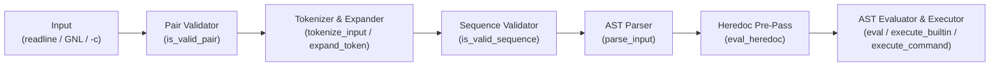

# minishell

[한국어](README.md) · [English](README.en.md)

42 Gyeongsan 팀 프로젝트로 C 언어, GNU Readline, 자체 구현 `libft`를 사용해 제작한 유닉스 셸.  
입력 구문 검증, Quote Masking 기반 토큰 확장, 재귀 하강 AST 파서(Recursive-Descent AST Parser), 파이프라인·리다이렉션 실행기, 시그널 격리까지 셸 실행 흐름 전반을 구현.

- **개발 기간**: 2025.07.14 ~ 2025.08.30 (273 commits, `-Wall -Wextra -Werror`, 42 Norminette 준수)
- **팀원**: [`yoshin`](https://github.com/gdtknight) · [`jyoo`](https://github.com/Sunbear95)

---

## 아키텍처 및 실행 파이프라인

사용자 입력 처리 순서: 구문 쌍 검사 → 토크나이징 및 확장 → 토큰 시퀀스 검증 → AST 생성 → Heredoc 선행 평가 → 노드 실행.



### 단계별 동작

1. **입력 수집 (`srcs/main.c`)**
   - TTY 환경: `readline(PROMPT)`로 대화형 프롬프트 출력 및 `add_history` 이력 관리
   - 비대화형 환경(`!isatty(STDIN_FILENO)`): 파이프·중첩 실행 시 `get_next_line`으로 줄 단위 입력 수신
   - 단일 명령 옵션: `minishell -c "<command>"` 형식으로 단일 명령 즉시 실행
2. **구문 쌍 및 시퀀스 검증 (`srcs/utils/pair_validator.c`, `srcs/tokenize/token_validatation.c`)**
   - `is_valid_pair()`: 단일·이중 따옴표(`'`, `"`)와 이스케이프(`\`) 짝 미종결 여부 선행 검사
   - `is_valid_sequence()`: 선두 연산자 오류, 괄호 `()` 짝 불일치, 리다이렉션 뒤 피연산자(`TK_WORD`) 누락 검증
3. **Quote Masking 기반 토크나이징 및 확장 (`srcs/tokenize/`, `srcs/expand/`)**
   - `t_exp_token` 구조체로 문자열(`value`)과 문자별 상태 마스크(`qmask`: `MASK_UNQUOTED`, `MASK_QUOTED`, `MASK_IFS`) 병행 유지
   - 처리 순서: 틸드 확장(`~`, `~username`) → 파라미터 확장(`$VAR`, `$?`, `$$`, `$!`, `$0`) → IFS 기준 필드 분할(`split_field`) → 따옴표 제거(`quote_removal`)
   - 따옴표 내부 공백은 `MASK_QUOTED`로 보호해 변수 확장 후 의도치 않은 단어 분할 방지
   - 리다이렉션 대상이 확장 후 다중 단어로 분할될 경우 `check_ambigous()`가 `ambigous redirect` 오류 출력 후 실행 중단
4. **재귀 하강 AST 파서 (`includes/ast.h`, `srcs/ast/`)**
   - 연산자 우선순위 계층(`list` `;`/`&` → `and_or` `&&`/`||` → `pipeline` `|`/`|&` → `command` / `compound_command` `(...)`) 기반 Tagged Union `t_syntax_node` 트리 구성
   - 단일 명령 구성 분리: `prefix`(선행 리다이렉션 및 `VAR=val` 할당) · `cmd_word` · `suffix`(인자 및 후행 리다이렉션)
5. **2-Pass Heredoc 및 실행기 (`srcs/evaluation/`, `srcs/execution/`)**
   - 본 명령 실행 전 `eval_heredoc()`이 AST를 선회하며 `<<` 입력을 자식 프로세스에서 선행 수집 (리미터에 따옴표 부재 시 `expand_heredoc_input()`으로 환경변수 확장)
   - `eval_pipeline()`: 좌·우 자식 프로세스를 각각 `fork`하고 미사용 파이프 FD를 즉시 닫아 FD 누수 및 EOF 대기 방지
   - 리다이렉션이 동반된 빌트인 실행 직후 `restore_tty()`로 표준 입출력 복원
6. **환경변수 해시맵 & 시그널 격리 (`srcs/hashmap/`, `srcs/shell/`)**
   - 시작 시 `envp`를 크기 1024 체이닝 해시맵(`t_hash_map`)에 깊은 복사해 `export`, `unset`, `env`를 호스트 환경과 독립 운영
   - 대화형 `SIGINT`(Ctrl+C): 현재 입력 줄 초기화 및 종료 코드 `130` 기록 / `SIGQUIT`(Ctrl+\): 무시
   - 외부 명령 자식은 `execve` 직전 `restore_signal()`로 기본 시그널 복원, Heredoc 자식은 `heredoc_sigint_handler`로 즉시 정리 후 종료

---

## 지원 빌트인 명령어

| 명령어 | 지원 동작 및 세부 처리 |
| :--- | :--- |
| `echo` | `-n` 옵션 및 `-nnn` 연속 플래그 처리 |
| `cd` | 상대·절대 경로 이동, 인자 없음/`--` 시 `HOME` 이동, `-` 시 `OLDPWD` 이동 및 출력, `PWD`/`OLDPWD` 갱신 |
| `pwd` | `getcwd` 기반 현재 작업 디렉터리 출력, 실패 시 `perror("pwd")` 출력 |
| `export` | `KEY=VALUE` 등록·갱신, `KEY+=VALUE` 문자열 이어 붙이기, 식별자 문법 검사 |
| `unset` | 해시맵(`envp_map`)에서 지정한 환경변수 엔트리 제거 |
| `env` | 해시맵에 저장된 현재 환경변수 목록 출력 |
| `exit` | 64비트 정수 파싱(`ft_atoll`), `exit_code & 0xFF` 마스킹, 비숫자 인자 시 상태 `2` 종료, 다중 인자 시 상태 `1` 유지 후 셸 지속 |

---

## 빌드 및 실행

### 요구 사항

- `gcc`, `make`
- GNU Readline 라이브러리
  - **macOS (Homebrew)**: `brew install readline` (`Makefile`에서 `/opt/homebrew/opt/readline` 및 `/usr/local/opt/readline` 경로 자동 참조)
  - **Linux (Debian/Ubuntu)**: `sudo apt-get install libreadline-dev`

### 빌드 및 실행 예시

```bash
# 빌드
make

# 대화형 셸 실행
./minishell

# 단일 명령 실행 (-c)
./minishell -c 'echo "hello minishell" | cat'

# 디버그 심볼 포함 빌드 / 빌드 산출물 정리
make debug=1
make fclean
```

---

## 디렉터리 구조

```text
.
├── Makefile
├── includes/
│   ├── ast.h               # AST 노드 타입 및 파서 인터페이스
│   ├── builtin.h           # 빌트인 명령어 선언 및 상태 enum
│   ├── def.h               # 공통 boolean / status / result 정의
│   ├── eval.h              # AST 평가기 및 heredoc/pipe 인터페이스
│   ├── execute.h           # 명령 실행기 및 빌트인 디스패치 테이블
│   ├── expand.h            # Quote Masking 및 확장 파이프라인 선언
│   ├── flag.h              # 따옴표/이스케이프 상태 플래그
│   ├── get_next_line_bonus.h
│   ├── hashmap.h           # 1024 버킷 체이닝 해시맵 정의
│   ├── shell.h             # 전역 셸 상태(t_shell_data) 및 시그널/TTY 선언
│   ├── tokenizer.h         # 토큰 타입 및 토크나이저 인터페이스
│   └── utils.h             # 문자열/환경/구문쌍 유틸리티
├── libft/                  # 자체 구현 표준 라이브러리 및 연결 리스트
└── srcs/
    ├── main.c              # 진입점, 대화형 루프, -c 단일 명령 모드
    ├── ast/                # 재귀 하강 AST 파서 및 노드 해제/출력
    ├── builtin/            # echo, cd, pwd, export, unset, env, exit
    ├── evaluation/         # list/and_or/pipeline/command/redir/heredoc 평가
    ├── execution/          # PATH 탐색, execve 및 빌트인 실행
    ├── expand/             # tilde, param, heredoc 확장, IFS split, quote removal
    ├── hashmap/            # 환경변수 저장용 해시맵 CRUD 및 해제
    ├── shell/              # shell_data, input 정리, 시그널 핸들러, TTY 복원
    ├── tokenize/           # 토크나이저, 토큰 팩토리, 시퀀스 검증
    └── utils/              # char_utils, env_utils, ft_lltoa, GNL, pair_validator
```

---

## 구현 범위와 한계

과제 필수 요구사항과 평가 기준에 맞춘 구현 범위 및 제한 사항.

- **와일드카드(`*`) 미포함**: 초기 `wildcard_match` 및 `file_utils.c` 실험 코드를 최종 제출 시 필수 범위 집중을 위해 제외
- **인자 제한**: `-c <command>` 외 스크립트 파일 인자 미지원 (`minishell: arguments are not supported` 출력 후 종료 코드 `1` 반환)
- **인자 없는 `export`**: 인자 없이 호출 시 정렬된 `declare -x` 목록 출력 없이 종료 상태 `0` 반환

---

## 버전 히스토리

| 버전 | 날짜 | 주요 마일스톤 |
| :--- | :--- | :--- |
| `v0.1.0` | 2025-07-24 | 프로젝트 초기 구성, `Makefile` 빌드 설정 및 기본 Tokenizer 구현 (`#1`, `#2`) |
| `v0.2.0` | 2025-08-01 | 재귀 하강 AST 파서 초안, `envp` 깊은 복사용 Hashmap 및 `main` 골격 구축 (`#6`, `#7`, `#8`) |
| `v0.3.0` | 2025-08-08 | 빌트인 7종 초안, 토큰 시퀀스 검증, AST Evaluator 및 파이프/리다이렉션 실행 (`#2`, `#4`) |
| `v0.4.0` | 2025-08-16 | 시그널 처리, 환경변수·틸드(`~`) 확장 및 빌트인 통합 (`#4`, `#6`) |
| `v0.5.0` | 2025-08-25 | Quote Masking·IFS 필드 분할 기반 확장 엔진 개편 및 메모리/FD 누수 수정 (`#2`, `#7`, `#8`) |
| `v1.0.0` | 2025-08-30 | Heredoc 확장, `-c` 단일 명령 모드, 중첩 셸, `export +=`, Norminette 최종 준수 (`#1`, `#4`, `#6`) |
